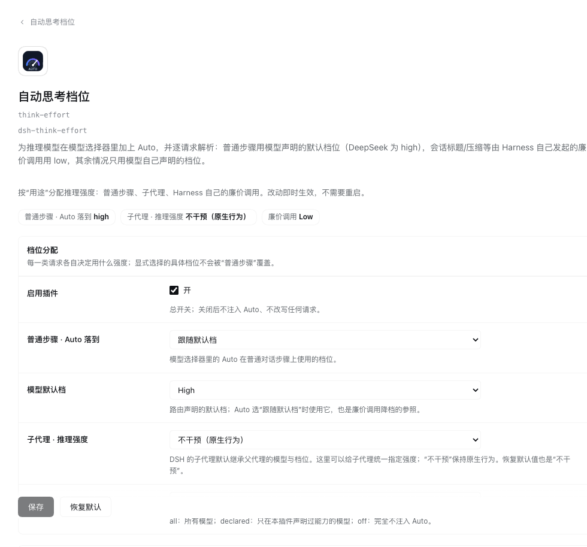

# Automatic thinking depth

Declarative thinking-depth control for DeepSeek (and other) reasoning models: the model selector gains `Auto`, `Auto` resolves to the model's declared default depth on every request (DeepSeek V4: `high`), and cheap host-owned calls — session titles, compaction, auto-review — drop to `low`.

## What it does

1. **Declares the capability (on by default).** A hand-declared DeepSeek gateway model under `llm-pi-ai` usually carries no reasoning metadata: the selector offers no depth, and any depth is refused. The plugin recognizes DeepSeek models by endpoint and model id and writes `reasoningEfforts` (default `low / high / max`) plus the route default depth (`high`) into the `llm-pi-ai` settings surface. A model that already declares `reasoningEfforts` — including an explicit `false` — is never touched.
2. **Offers `Auto`.** One `Auto` entry is prepended to the model's depth list.
3. **Resolves per request.** At the adapter boundary `auto` becomes the declared default; a request whose `purpose` is a cheap host-owned call becomes `low` when the model declares it — regardless of the session's own choice, because those bounded calls never inherit it; a manually picked depth passes through untouched and is validated by DSH itself.
4. **Subagent depth.** A subagent effort can be pinned (`inherit` / `auto` / `low`…`max`). `inherit` keeps DSH's native inheritance; a fixed depth overrides the child's own or inherited pick, while a cheap-call downgrade still wins.

## Usage

- Pick `Auto` in the model selector to state "use the default depth", or a concrete depth to pin it.
- Leaving the depth unset (the native "provider default" row) behaves like `Auto` on ordinary steps — both land on the declared default; `Auto` only records the intent in the session. The cheap-call downgrade applies either way.
- The recognized models, default depth and cheap-call list live in the plugin row's config (`think-effort` in `cordis.patch.yml`).
- The visual settings page is preferred: **Plugins → Automatic thinking depth → Configure**. Every field is `volatile`, so Save applies immediately without a restart.

## Limitations

- Capability declaration targets `llm-pi-ai` routes. Other adapters (for example the official DeepSeek account route) already carry metadata; the plugin only adds `Auto` there.
- The declaration is written into the profile's user layer, the same layer the Settings page edits. When that row is overridden by a higher layer (a `--patch` or home-patch override), the write is refused with a logged warning and `reasoningEfforts` has to be filled in by hand under Settings → Models.
- It never guesses a depth from tool names, argument sizes or conversation text: those signals carry no difficulty information, and a low guess is inherited by every later step.

## Configuration

| Field | Default | Meaning |
|---|---|---|
| `enabled` | `true` | Master switch |
| `declareCapability` | `true` | Write `reasoningEfforts` |
| `deepseekHosts` | `['deepseek.com']` | Host suffixes treated as official DeepSeek |
| `deepseekModelPattern` | `^deepseek` | Model-id test for gateway aliases |
| `declareModels` | `[]` | Extra `provider/model` keys or model-id tests |
| `efforts` | `low, high, max` | Declared DeepSeek depth vocabulary |
| `defaultEffort` | `high` | Route default depth; where `Auto` lands |
| `autoLevel` | `model-default` | Or a fixed depth |
| `auxDowngrade` | `true` | Downgrade cheap host-owned calls |
| `auxPurposes` | `session-title, compaction, auto-review` | Purposes treated as cheap |
| `auxLevel` | `low` | Depth those calls request |
| `autoScope` | `all` | `all` / `declared` / `off` |
| `subagentLevel` | `inherit` | Subagent depth: `inherit` / `auto` / a fixed depth; a fixed depth overrides the child's own or inherited pick |
| `trace` | `false` | Write decisions to stderr for diagnosis |

## Diagnostic tool

An Agent can call `reasoning_effort_status` for a provider/model: it reports the declared depths, the default, what `Auto` and subagents resolve to, and the cheap-call depth, without sending any model request.