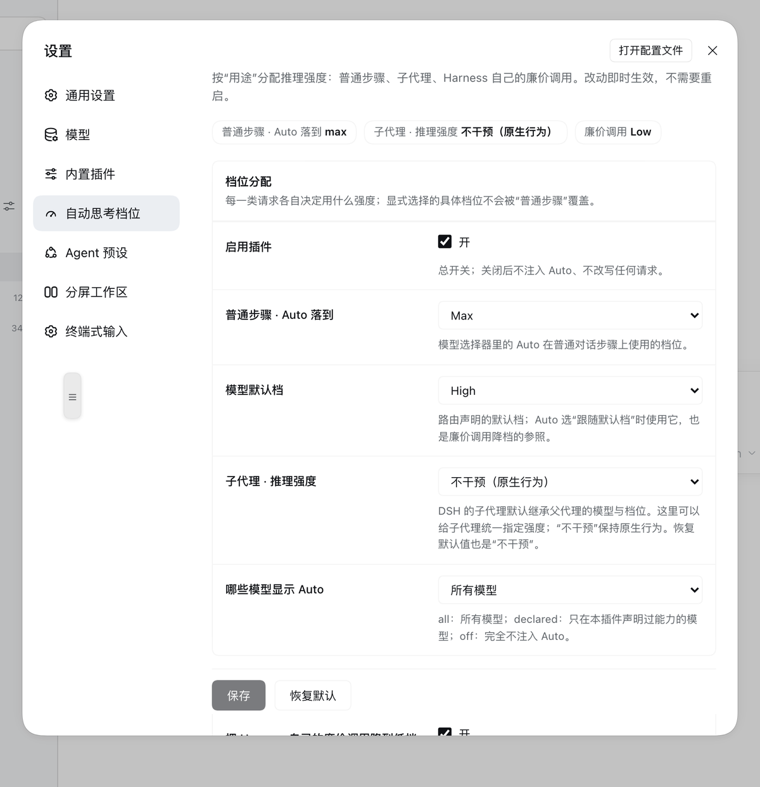

# 自动思考档位

给 DeepSeek 等推理模型补上一套声明式的思考档位控制：模型选择器里出现 `Auto`，`Auto` 在每次请求落到模型声明的默认档（DeepSeek V4 = `high`），而会话标题、压缩、自动复审这类 Harness 自己发起的廉价调用自动用 `low`。

## 它做什么

1. **声明能力（默认开启）**：手工在 `llm-pi-ai` 里声明的 DeepSeek 网关模型通常没有推理元数据——选择器里没有任何档位，任何档位也会被拒绝。插件按 endpoint 与模型 ID 识别 DeepSeek 模型，把 `reasoningEfforts`（默认 `low / high / max`）与路由默认档（`high`）写进 `llm-pi-ai` 的设置面。已经有 `reasoningEfforts`（包括显式 `false`）的模型不会被改动。
2. **提供 `Auto`**：在模型目录的档位列表最前面补一个 `Auto`。
3. **逐请求解析**：在适配器边界把 `auto` 换成声明默认档；`purpose` 属于廉价调用时换成 `low`（仅当模型声明了它，且**与会话选了什么都无关**——会话标题/图片摘要本来就不继承会话档位）；手动选的档位一律原样透传，由 DSH 自己校验。
4. **子代理档位**：可给子代理统一指定强度（`inherit` / `auto` / `low`…`max`）。`inherit` 保持 DSH 原生继承；固定档会覆盖子代理自身或从父代理继承的选择，廉价调用的降档仍然优先。
5. **实时调试日志**：可选的悬浮窗，展示每次请求的档位决策（请求档位 → 实际档位），包括子代理会话；只记录，不改变任何请求。

## 使用

- 在模型选择器里选 `Auto` 即声明「按默认档走」；选具体档位即固定该档位。
- 不选任何档位（原生“提供方默认”）在普通步骤上与 `Auto` 等效，都会落到声明默认档；差别只是 `Auto` 把意图记录进会话。廉价调用的降档在任何情况下都生效。
- 识别范围、默认档、廉价调用清单都在插件配置里（`cordis.patch.yml` 的 `think-effort` 行）。
- 可视化设置有**两个入口**，表单与写入相同：**设置 → 自动思考档位**（推荐），或**插件 → 自动思考档位 → 行「配置」**。字段全部是 `volatile` 配置，保存后立即生效（无需重启）。

## 实时调试日志

设置页「调试 → 在会话界面显示实时档位切换日志」打开后，会话右下角出现一个可拖动的悬浮窗（`shell.overlay` 槽位），实时显示：

- 每次模型请求的时间、用途、请求档位与实际发送档位、模型；
- 子代理会话的决策（带「子」标记）——子代理与主会话在同一个 Host 进程里，共用同一份日志；
- `设置更新` 与 `能力声明` 事件，便于确认保存是否生效；
- 「当前会话 / 全部会话 / 仅切换」筛选与一键复制。

实现分两半：Host 半边在适配器边界把每条决策写入一个**内存环形缓冲**（最多 300 条，不写会话日志、不落盘），并通过两条 `webServer` 路由提供增量读取与清空；浏览器半边按开关状态轮询，只在打开时请求，窗口位置与展开状态存在浏览器本地。关掉开关后路由返回 `enabled: false`，窗口消失、记录停止。

## 设置页从哪里来

- 插件行页面注册进插件管理器的 `plugins.row.config`，键为 `dsh-think-effort#think-effort`；
- 设置页注册进设置面板的 `settings.section`（`id` 同为 `think-effort`，`order: 16`，紧跟 order 15 的内置插件），图标注册进 `settings.section.icon` 且 `id` 必须与之一致；
- 设置页没有 owner 传入的表单，所以它从 `configForms` 服务读取**行设置命名空间**（即 profile 条目 id `think-effort`）。`whileServed(['think-effort'])` 保证只有 Host 正在提供该命名空间时才注册，页面不会在没有这一行的部署里留下空壳；
- 两个入口共用 `configForms` 里同一个表单控制器，因此任一入口的保存都是同一次 profile 写入。

## 限制

- 只对 `llm-pi-ai` 路由声明能力：其他适配器（例如官方 DeepSeek 账户路由）本来就自带元数据，插件只补 `Auto`。
- 声明会写进 profile 的用户层配置（与设置页编辑同一层）。若该行被更高层（`--patch` 覆盖、home patch 覆盖）压住，写入会被拒绝并记录警告，此时需要手动在「设置 → 模型」里填写 `reasoningEfforts`。
- 不按工具名、参数大小或对话内容猜档位：这些信号不携带难度信息，一次猜低会被后续步骤继承。

## 配置项

| 字段 | 默认 | 说明 |
|---|---|---|
| `enabled` | `true` | 总开关 |
| `declareCapability` | `true` | 是否写 `reasoningEfforts` |
| `deepseekHosts` | `['deepseek.com']` | 视为官方 DeepSeek 的 host 后缀 |
| `deepseekModelPattern` | `^deepseek` | 模型 ID 正则（网关别名用） |
| `declareModels` | `[]` | 额外要声明的 `provider/model` 或模型 ID 正则 |
| `efforts` | `low, high, max` | 声明给 DeepSeek 的档位 |
| `defaultEffort` | `high` | 路由默认档，`Auto` 落在这里 |
| `autoLevel` | `model-default` | 也可指定固定档位 |
| `auxDowngrade` | `true` | 廉价调用是否降档 |
| `auxPurposes` | `session-title, compaction, auto-review` | 视为廉价调用的 `purpose` |
| `auxLevel` | `low` | 廉价调用用的档位 |
| `autoScope` | `all` | `all` / `declared` / `off` |
| `subagentLevel` | `inherit` | 子代理档位：`inherit` / `auto` / 固定档；固定档覆盖子代理自身或继承的选择 |
| `debugOverlay` | `false` | 会话界面的实时档位切换日志（只记录，不改请求；Host 内存最多 300 条） |
| `trace` | `false` | 把决策写到 stderr（排查用） |

## 诊断工具

会话里可以让 Agent 调 `reasoning_effort_status`：它报告某模型声明的档位、默认档、`Auto` 与子代理的解析结果、廉价调用档位，不发任何模型请求。